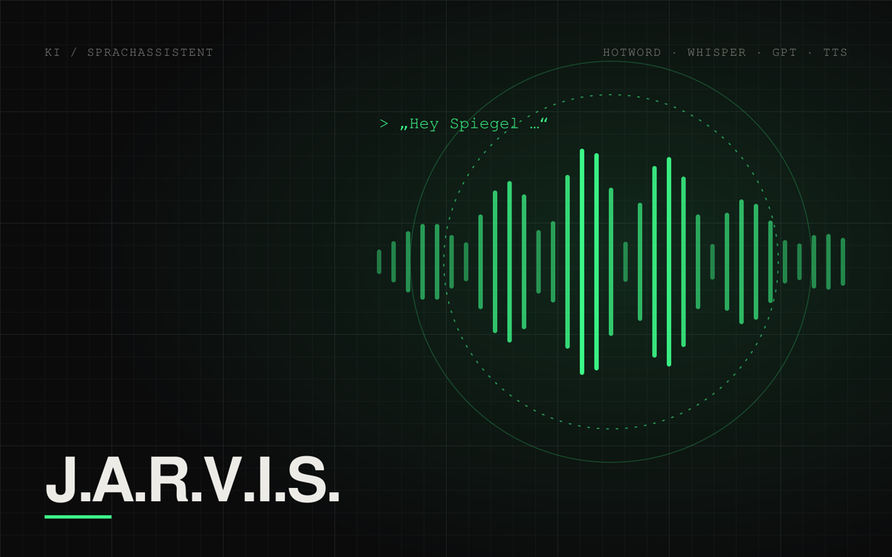
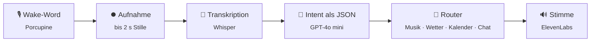

<p align="center">
  
</p>

<p align="center">
  <a href="https://tarek.vision">
    
  </a>
</p>

<p align="center">
  <a href="https://tarek.vision"></a>
</p>

---

### `> whoami`

Hi, ich bin **Tarek**. Ich will verstehen, wie Systeme funktionieren, vom Motor im Gelenk bis zum Paket im Netzwerk, und baue sie deshalb lieber selbst.
Code ist für mich erst fertig, wenn er **etwas in der echten Welt bewegt** – und wenn er dabei sicher bleibt.

```yaml
fokus:    [Robotics, Software, IT-Systeme, Security]
gerade:   J.A.R.V.I.S. & ein Roboterarm, der meiner Hand folgt
lernt:    [ROS 2, Netzwerk-Security]
homelab:  online 🟢
motto:    Make it move.
```

---

### 🎙️ Featured: J.A.R.V.I.S.



Mein eigener **KI-Sprachassistent für einen Smart Mirror**. Er lauscht auf sein Wake-Word, hört zu, bis ich fertig bin, versteht, was ich will, und antwortet mit echter Stimme.



---

### 🦾 Robotics

<table>
  <tr>
    <td width="50%" valign="top">
      <a href="https://github.com/TarekIbr/hand-teleop-robot-arm"></a>
      <h4><a href="https://github.com/TarekIbr/hand-teleop-robot-arm">hand-teleop-robot-arm</a></h4>
      Einen Roboterarm in PyBullet mit der eigenen Hand steuern, nur über die Webcam – inklusive Aufnahme von Demonstrationsdaten.<br/><br/>
      <code>Python</code> <code>PyBullet</code> <code>OpenCV</code> <code>MediaPipe</code>
    </td>
    <td width="50%" valign="top">
      <a href="https://github.com/TarekIbr/robot-log-analyzer"></a>
      <h4><a href="https://github.com/TarekIbr/robot-log-analyzer">robot-log-analyzer</a></h4>
      Roboter-Logs auswerten, Fehler pro Komponente finden und automatisch einen Support-Ticket-Text mit Eskalation schreiben.<br/><br/>
      <code>Python</code> <code>Rich</code> <code>CLI</code>
    </td>
  </tr>
</table>

### 🛠️ Software & Infrastruktur

| | Projekt | Worum es geht |
|:-:|---|---|
| 🧠 | **[openclaw-brain](https://github.com/TarekIbr/openclaw-brain)** | Control-Dashboard für KI-Agents mit Realtime-Chat, Logs und Tasks · React, TypeScript, Fastify, Docker |
| 💬 | **ReviewFlow** | Feedback-Plattform für lokale Unternehmen · React, TypeScript, Supabase, Stripe |
| ✨ | **[Portfolio](https://github.com/TarekIbr/Portfolio)** | [tarek.vision](https://tarek.vision) – WebGL, GSAP und ein Carousel, das Videos kann |

---

### ⚙️ Stack

<p align="center">
  <br/>
  
</p>

<p align="center">
  
</p>

---

<p align="center">
  <b>Mehr Projekte, Lab Notes und wer ich bin:</b><br/><br/>
  <a href="https://tarek.vision"></a>
</p>

<p align="center">
  
</p>
